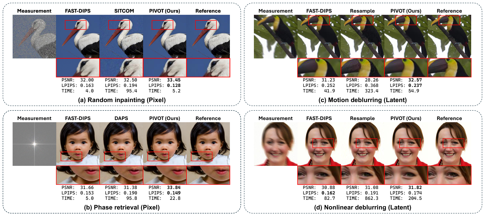
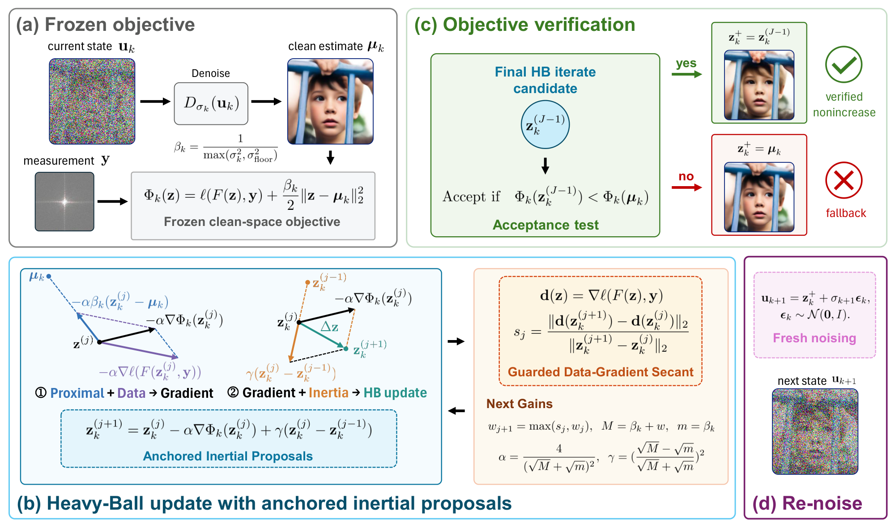

# PIVOT

**Anchored Inertial Proposals with Objective Verification for Diffusion-Prior Inverse Problems**  
Minwoo Kim<sup>∗</sup>, Seunghyeok Shin<sup>∗</sup>, Dabin Kim, Hongki Lim<sup>†</sup> · Inha University  
<sup>∗</sup>Equal contribution · <sup>†</sup>Corresponding author

| Project page | NeurIPS 2026 | OpenReview | GitHub | arXiv |
| --- | --- | --- | --- | --- |
| [PIVOT](https://pivot-2026.github.io/) | [Poster](https://neurips.cc/virtual/2026/loc/sydney/poster/155032) | [Paper and reviews](https://openreview.net/forum?id=8wurOw8o4D) | [Code](https://github.com/Seunghyeok0715/PIVOT2026git) | |

PIVOT (**Propose with Inertia, Verify with an Objective Test**) reconstructs images from noisy measurements with a pretrained diffusion model. At each noise level, it uses the denoiser prediction as an anchor, proposes a correction, and keeps that correction only if it improves a measurement objective that also penalizes moving away from the anchor. The same rule operates in pixel space and through a decoder in latent space.



## Run your first reconstruction

Use Python 3.10 and a CUDA-enabled GPU for the benchmark. Install the pixel dependencies from a Bash shell.

```bash
git clone https://github.com/Seunghyeok0715/PIVOT2026git.git
cd PIVOT2026git
python3.10 -m venv .venv
source .venv/bin/activate
python -m pip install torch==2.3.0 torchvision==0.18.0 --index-url https://download.pytorch.org/whl/cu121
python -m pip install -r requirements.txt
```

For the example below, download the FFHQ pixel checkpoint to `checkpoints/ffhq256.pt` and extract the test images under `dataset/test-ffhq/`. The asset guide includes the download commands, ImageNet weights, and additional packages for latent diffusion. [Checkpoints and data](docs/assets.md) · [Latent setup](docs/assets.md#latent-environment)

Reconstruct the first FFHQ image at 4× super-resolution with the paper's pixel budget:

```bash
python main.py --data test-ffhq --model ffhq256ddpm --task down_sampling --K 40 --J 15 --sigma_y 0.05 --batch_size 1 --data_start_id 0 --data_end_id 1 --seed 42 --gpu 0 --name ffhq_sr4
```

Open `results/ffhq_sr4/samples/00000_run0000.png` for the reconstruction or `grid_results.png` in the same directory for the reference, measurement, and reconstruction together. The runner also writes PSNR, SSIM and LPIPS to `metrics.json` and sampling time to `sampling_diagnostics.json`. The default LPIPS metric fetches VGG weights on first use.

## How PIVOT chooses a correction



At noise level $k$, the denoiser produces a clean prediction $\mu_k$. PIVOT freezes this anchor and scores clean states $z$ with

$$
\Phi_k(z) = \frac{\lVert A(G(z))-y\rVert_2^2}{2\sigma_y^2}
          + \frac{\beta_k}{2}\lVert z-\mu_k\rVert_2^2,
\qquad \beta_k=\frac{1}{\max(\sigma_k,10^{-3})^2}.
$$

Here $y$ is the measurement, $A$ is the forward operator, and $G$ is the identity in pixel space or the pretrained decoder in latent space.

1. **Propose.** Starting at the anchor, take $J-1$ heavy-ball steps. Changes in the data gradient along the iterates estimate local curvature and determine step size and momentum. An increase in the frozen objective resets the momentum.
2. **Verify.** Evaluate the final proposal and the anchor on the same frozen objective. A strict decrease accepts the proposal. Otherwise the anchor is selected. This gives a per-level guarantee, $\Phi_k(z_k^+)\leq\Phi_k(\mu_k)$.
3. **Continue sampling.** Add fresh Gaussian noise at the next scheduled level to the selected state. At the last level the noise scale is zero.

Each level uses one denoiser call, $J$ data-gradient evaluations and one gradient-free verification. A single extra gradient probe initializes the curvature at the first level. [Sampler implementation](main.py)

## Reproduce the natural-image benchmarks

The release covers eight tasks on 256 × 256 images with FFHQ and ImageNet pixel and latent priors. Each task uses the same budget on both datasets. The numbers below are the reverse levels $K$ and data-gradient evaluations per level $J$ from Table 3.

| Task | CLI task | Pixel K / J | Latent K / J |
| --- | --- | ---: | ---: |
| 4× super-resolution | `down_sampling` | 40 / 15 | 50 / 24 |
| Box inpainting | `inpainting` | 90 / 15 | 100 / 24 |
| Random inpainting | `inpainting_rand` | 100 / 15 | 50 / 20 |
| Gaussian deblurring | `gaussian_blur` | 20 / 140 | 50 / 30 |
| Motion deblurring | `motion_blur` | 40 / 20 | 50 / 30 |
| Phase retrieval | `phase_retrieval` | 180 / 70 | 70 / 35 |
| Nonlinear deblurring | `nonlinear_blur` | 120 / 120 | 70 / 80 |
| High dynamic range | `hdr` | 40 / 20 | 20 / 100 |

Choose the command for your dataset, prior, and task from the recipe file. Each command uses 100 images, batch size 1, seed 42, and a Gaussian likelihood with $\sigma_y=0.05$. Phase retrieval uses four draws per image and all other tasks use one. [Benchmark commands](configs_pivot_cli.txt) · [Reproduction guide](docs/reproduction.md) · [Table 1 results](docs/results.md)

The paper also evaluates accelerated multi-coil knee MRI. The runnable commands here cover the FFHQ and ImageNet experiments.

## Citation

```bibtex
@inproceedings{kim2026pivot,
  title     = {Anchored Inertial Proposals with Objective Verification for Diffusion-Prior Inverse Problems},
  author    = {Kim, Minwoo and Shin, Seunghyeok and Kim, Dabin and Lim, Hongki},
  booktitle = {Advances in Neural Information Processing Systems},
  year      = {2026},
  url       = {https://openreview.net/forum?id=8wurOw8o4D}
}
```

The implementation builds on the diffusion and inverse-problem infrastructure in FAST-DIPS and DAPS, the BKSE nonlinear blur model, and the motionblur kernel generator. [FAST-DIPS](https://github.com/ququlza/FAST-DIPS) · [DAPS](https://github.com/zhangbingliang2019/DAPS) · [BKSE](https://github.com/VinAIResearch/blur-kernel-space-exploring) · [motionblur](https://github.com/LeviBorodenko/motionblur)
